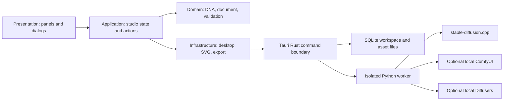

# Module ownership

`use-studio.ts` is the current concrete application composition point; it binds the narrow desktop adapter functions and pure domain operations. There is no invented dependency-injection framework or shared JavCollections runtime. Domain modules have no platform, UI or network imports. The native `Store` owns repository transactions; Python providers are interchangeable adapters behind one validated process protocol.

The UI presents images through image elements, never untrusted inline SVG. Generation, raster reference, trace and geometric composition have separate provenance and export paths. A saved version is a copy of the editable composition, not a claim to preserve the model's latent state.

Future extraction candidates are pure Brand DNA resolution, vector document schemas and semantic design tokens. Such extraction should follow a demonstrated second consumer; JavDesign and JavParlance are not imported.
